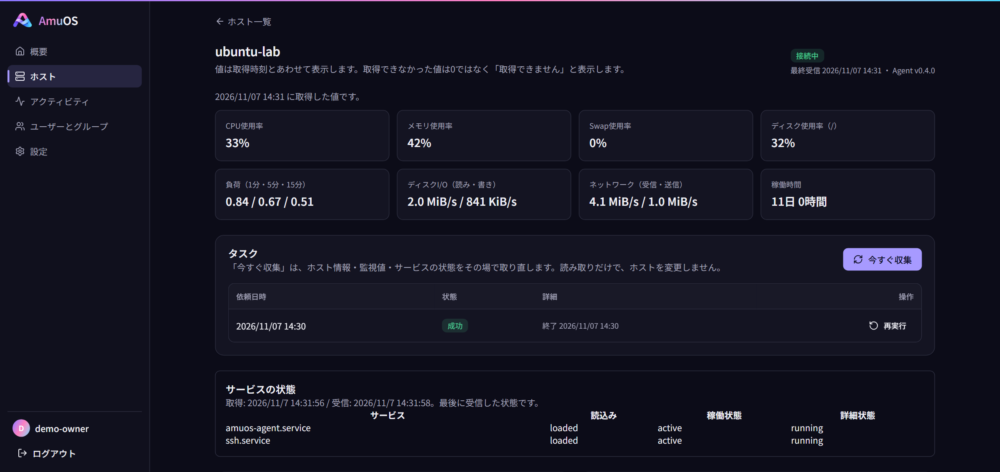
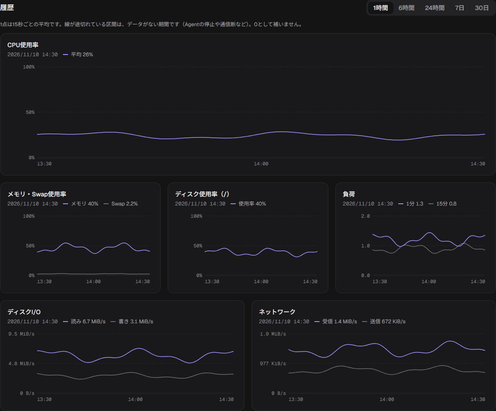
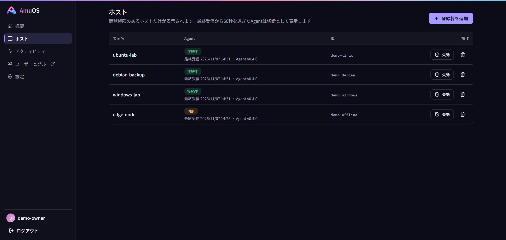
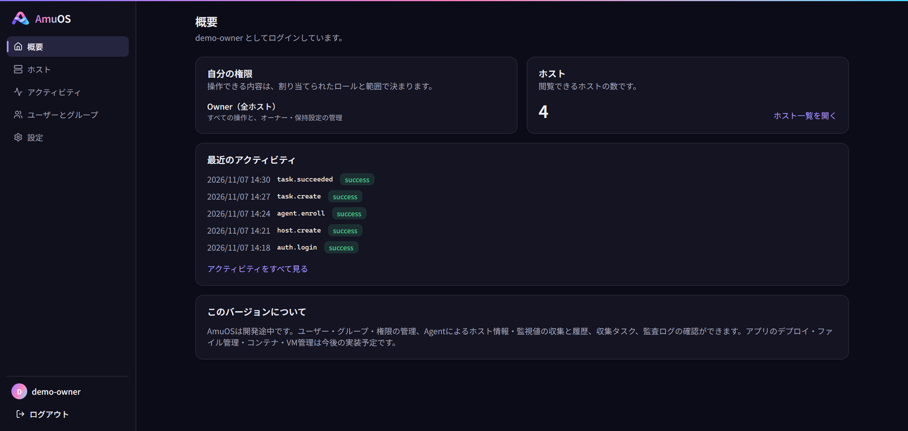

<div align="center">


# AmuOS

**Weaving scattered tools into one place.**

A self-hosted project for managing Linux and Windows hosts through one web interface

[日本語](README.md) · **English**

[](https://github.com/sudatti624/AmuOS/actions/workflows/test.yml)
[](LICENSE)


[Releases](https://github.com/sudatti624/AmuOS/releases) · [Install on Linux](docs/INSTALL.md) · [Install on Windows](docs/INSTALL-WINDOWS.md) · [Roadmap](#roadmap)

</div>

AmuOS aims to bring hosts, applications, files, monitoring, and permissions together under one URL and one login. It installs on an existing operating system without requiring an OS reinstall.

The current published version is **v0.4.0 (pre-release)**. It provides authentication and access control, Agent-based host monitoring, audit logs, backups and recovery, and service installation and updates on Linux and Windows. **Application deployment, file management, Docker/Compose, and VM management are planned features.**

> [!WARNING]
> AmuOS is in early development. APIs and data formats may change without notice. Please avoid using it in production or exposing it to the public internet. See each release's notes and installation guide for supported features and limitations.

## Contents

- [Available features](#available-features)
- [Supported environments](#supported-environments)
- [Getting started](#getting-started)
- [Architecture](#architecture)
- [Roadmap](#roadmap)
- [Development](#development)
- [Documentation](#documentation)
- [Use of AI](#use-of-ai)
- [Issues / PRs](#issues--prs)
- [License](#license)

<p align="center">
  
  <br>
  <sub>The current host details UI with sample data. Values are illustrative, not measurements from a real host.</sub>
</p>

<details>
<summary>View monitoring, host list, and overview screenshots</summary>

These screenshots also show the current UI with sample data. The display varies by version and configuration.

**Monitoring history** — CPU, memory, disk, and network trends.



**Host list** — Multiple hosts and their Agent connection status.



**Overview** — Assigned permissions, host count, and recent activity.



</details>

## Available features

| Feature | Current scope |
|---|---|
| Accounts and permissions | Initial Owner setup, invitations, users and groups, and fixed Owner / Admin / Operator / Viewer roles with global or host-level assignments. Owner changes require reauthentication |
| Hosts and Agents | One-time enrollment codes, mTLS connections, automatic credential renewal, connection status, revocation, and deletion |
| Monitoring and history | Host CPU, memory, disk, and network metrics; host information; history charts; configurable collection intervals and retention. Linux also supports systemd status reporting |
| Collection tasks | Collect now, task status and results, cancellation before dispatch, manual re-runs as new tasks with retry limits, and manual resolution of unknown results |
| Audit logs | Important operations and rejected requests, before/after summaries, request IDs, configurable retention, and expired-log cleanup |
| Operations | Encrypted backups while stopped, restoration to the same product version, background services, updates, and rollback. Agents must enroll again after a Control Plane restore |

The web interface is currently in Japanese, with dark/light themes and layouts for narrow screens. AmuOS uses HTTPS, backend authorization, Argon2id, Origin and CSRF checks, and login rate limits.

## Supported environments

| Environment | Package and main differences | Installation guide |
|---|---|---|
| Linux amd64 | A tar.gz package for Ubuntu Server 24.04 LTS / Debian 13. Control Plane and Agent run as systemd services | [Linux installation](docs/INSTALL.md) (Japanese) |
| Windows amd64 | A ZIP package for Control Plane and Agent, using Windows services, dedicated accounts, and NTFS access controls. WSL is not required | [Windows installation](docs/INSTALL-WINDOWS.md) (Japanese) |

On Windows, load averages, swap, boot time, systemd status, and CPU usage on hosts with more than 64 logical CPUs are unavailable. Disk I/O requires accessible Windows performance counters. Missing values are not reported as zero. See the [v0.4.0 release notes](docs/releases/v0.4.0.md) (Japanese) for details and tested environments.

## Getting started

1. Download the package for your OS and `SHA256SUMS` from [Releases](https://github.com/sudatti624/AmuOS/releases), then verify its hash.
2. Follow the OS-specific guide above to prepare an HTTPS certificate and private key, install the Control Plane, and create the initial Owner.
3. Create a host in the web interface and enroll its Agent with an enrollment code. Host details show information, metrics, and history.

| OS | Package filename |
|---|---|
| Linux | `amuos_<version>_linux_amd64.tar.gz` |
| Windows | `amuos_<version>_windows_amd64.zip` |

An Agent on another host also needs matching certificate names, listen addresses, and network connectivity. Before updating, please keep a backup and retain the previous binary together with the pre-update data for rollback. The [backup and recovery guide](docs/BACKUP.md) (Japanese) describes the scope and limitations.

## Architecture

Browsers connect to the Control Plane over HTTPS. Each host's Agent connects to the Control Plane and uses a dedicated mTLS listener after enrollment. The web interface is embedded in the Control Plane binary; running the application does not require a persistent Node.js process.

| Component | Main responsibilities and technologies |
|---|---|
| Control Plane | Authentication, authorization, APIs, state, and auditing. Go, chi, SQLite, Argon2id |
| Agent | Host information and metrics collection, task reception, and result journaling. Go, mTLS |
| Web UI | A shared management interface. React, TypeScript, Vite+, Tailwind CSS, Radix UI |
| Verification | Go unit/integration tests, web tests, Playwright E2E, and package installation, update, and recovery tests |

## Roadmap

For v1.0, we aim to connect file placement, runtime configuration, deployment, startup, logs and monitoring, updates, and rollback through shared authentication, permissions, auditing, and tasks. We plan to validate these features together before considering v1.0 complete.

| Version | Milestone | Status |
|---|---|---|
| v0.1–v0.4 | Authentication and permissions, auditing, backup/recovery, Agent monitoring, and Linux/Windows foundations | Released |
| v0.5 | CI-led foundation verification: authorization, recovery, load, and failure scenarios | Additional tests implemented; CI acceptance pending |
| v0.6 | Browsing, transferring, editing, and organizing files within permitted directories | Planned |
| v0.7 | Application runtimes, deployment, lifecycle controls, logs/monitoring, updates, and rollback | Planned |
| v0.8 | Container deployment and operation with Docker/Compose | Planned |
| v0.9 | Basic VM management and backup/recovery through one supported virtualization engine | Planned |
| v1.0 | Release verification of integrated operations, permissions, and failure recovery across the main features | Planned |

Additional verification tests for v0.5 are implemented; overall CI acceptance is pending. Work on v0.6 and later has not started. Versions describe milestones, not release dates. Deployment, container, and VM features will initially target Linux hosts, with management also available through a Control Plane running on Windows.

Release decisions will primarily use CI for core workflows, authorization, and failure recovery. A 24-hour run or a separate manual environment check is not a universal release requirement. Environment-specific issues will be collected through Issues and, where possible, covered by regression tests after fixes. See the [development plan](docs/PLAN.md) and [specification](docs/SPECIFICATION.md) (Japanese).

## Development

The Go version is listed in [.go-version](.go-version), and Node.js and pnpm requirements are in [package.json](web/package.json). The project currently uses Go 1.27.3, Node.js 24, and pnpm 12.

<details>
<summary>Build from source</summary>

The web interface is built first, so it can be embedded in the Control Plane binary. The Control Plane and Agent can then be built with the commands below.

```sh
git clone https://github.com/sudatti624/AmuOS.git
cd AmuOS
cd web
pnpm install --frozen-lockfile
pnpm exec vp build
cd ..
```

Linux:

```sh
go build -o dist/controlplane ./cmd/controlplane
go build -o dist/agent ./cmd/agent
```

Windows (PowerShell):

```powershell
go build -o dist/controlplane.exe ./cmd/controlplane
go build -o dist/agent.exe ./cmd/agent
```

Building does not register services or perform initial setup. See the [operations guide](docs/OPERATIONS.md) (Japanese) for development startup, or the OS-specific installation guides for service installation.

</details>

<details>
<summary>Run checks and tests</summary>

From the repository root:

```sh
go fmt ./...
go vet ./...
go test ./...
```

From `web/`:

```sh
pnpm exec vp check
pnpm exec vp test
pnpm exec vp build
```

E2E tests require the Control Plane, Agent, development certificate tool binaries, and Playwright. See the [testing guide](docs/TESTING.md) (Japanese) for instructions and scope, and the [workflow](.github/workflows/test.yml) for CI commands.

</details>

## Documentation

| Topic | Resources (Japanese) |
|---|---|
| Installation and updates | [Linux](docs/INSTALL.md) / [Windows](docs/INSTALL-WINDOWS.md) |
| Backup and recovery | [Procedures and limitations](docs/BACKUP.md) |
| Specification and plans | [Specification](docs/SPECIFICATION.md) / [Development plan](docs/PLAN.md) |
| Architecture and decisions | [Architecture](docs/ARCHITECTURE.md) / [ADRs](docs/DECISIONS.md) |
| APIs and authorization | [API contract](docs/API.md) / [Authorization matrix](docs/API_AUTHORIZATION.csv) |
| Startup, testing, and progress | [Operations](docs/OPERATIONS.md) / [Testing](docs/TESTING.md) / [Progress](docs/PROGRESS.md) |
| Security and reporting | [Security design](docs/SECURITY.md) / [Vulnerability reporting](SECURITY.md) |

Detailed documentation and the web interface are primarily in Japanese. [README.md](README.md) is the main Japanese README; this English version covers the same overview, installation links, and roadmap.

## Use of AI

AmuOS is developed primarily using AI tools. The maintainer sets the development direction and decides when to release. Automated tests and CI are used to check behavior.

Implementation and verification status, known limitations, and items that remain unimplemented or unverified are documented in the [development plan](docs/PLAN.md) and [progress records](docs/PROGRESS.md).

The project is still in development, and tests may not detect every problem. If you notice a bug or unexpected behavior, we would appreciate hearing about it through an Issue.

## Issues / PRs

Issues and PRs are greatly appreciated. If you notice a bug, we would appreciate an [Issue](https://github.com/sudatti624/AmuOS/issues/new?template=bug_report.yml) with any available details about the version, environment, and reproduction steps. If you include logs, please remove any secrets first. Small code and documentation fixes are welcome, too. Further details are in [CONTRIBUTING.md](CONTRIBUTING.md) (Japanese).

For vulnerabilities, we ask that you avoid public Issues and use the private reporting channel in [SECURITY.md](SECURITY.md). Thank you for helping us handle these reports safely. You are not required to publish your modifications, but shared improvements are appreciated.

## License

AmuOS is released under the [Apache License 2.0](LICENSE). You may use, modify, and redistribute it for personal or commercial purposes under the license's terms. When redistributing, retain the license text and applicable copyright and attribution notices.

The software is provided "AS IS", without warranties of any kind, express or implied. To the extent permitted by applicable law, the developer is not liable for defects, data loss, or other damages arising from its use. Please refer to Sections 7 and 8 of the license for the exact terms. The project continues to work toward better stability, reliability, and security.

### Logo

The AmuOS logo (`docs/images/logo.png`, `web/public/favicon.png`, and `web/src/assets/logo.png`) is excluded from the Apache License 2.0.

- You may use the unmodified logo to introduce or link to AmuOS.
- We ask that the logo remain unmodified, not be used for unrelated products or services, and not imply endorsement or affiliation by the AmuOS developer.
- When distributing a modified version of AmuOS, please replace the logo so that it can be distinguished from the original project.

AmuOS relies on many open-source projects, including chi, modernc.org/sqlite, golang.org/x/crypto, React, Radix UI, Tailwind CSS, and Vite+. Thank you to everyone who makes this software available.
