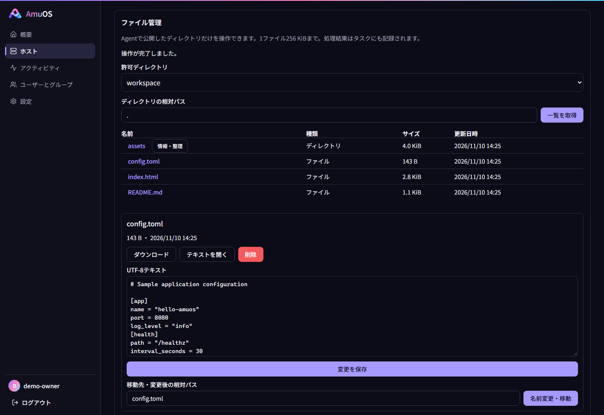
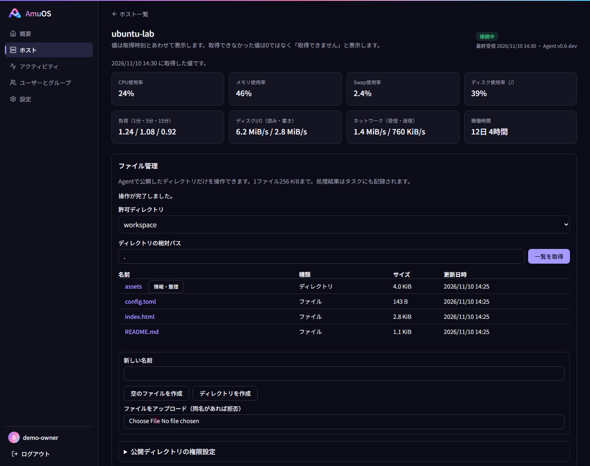
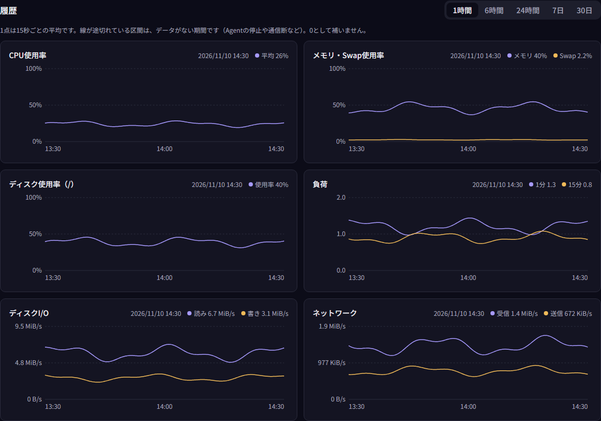
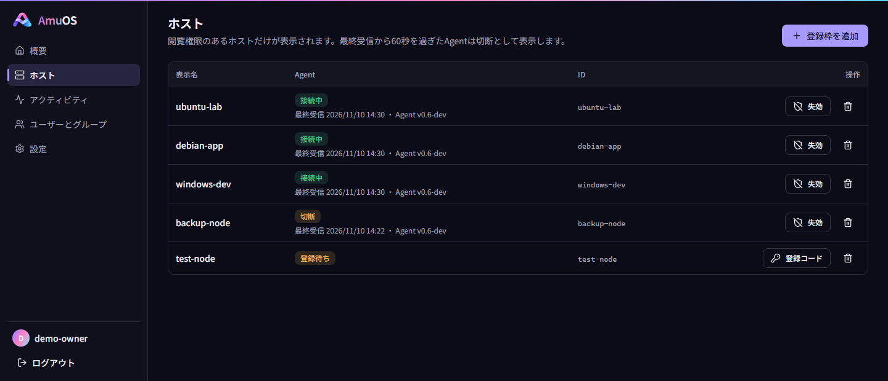
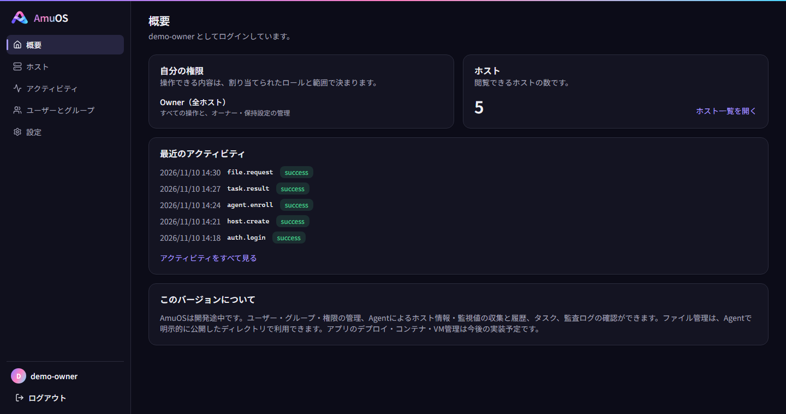

<div align="center">


# AmuOS

**散らばった機能を、一枚に編む。**

Linux・Windowsのホストを、一つのWeb画面から管理するセルフホスト型のプロジェクト

**日本語** · [English](README.en.md)

[](https://github.com/sudatti624/AmuOS/actions/workflows/test.yml)
[](LICENSE)


[Releases](https://github.com/sudatti624/AmuOS/releases) · [Linuxへの導入](docs/INSTALL.md) · [Windowsへの導入](docs/INSTALL-WINDOWS.md) · [ロードマップ](#ロードマップ)

</div>

AmuOSは、ホスト・アプリケーション・ファイル・監視・権限を、一つのURL・一つのログインで扱える管理環境を目指しています。既存のOSに導入でき、OSの再インストールは必要ありません。

現在の公開版は **v0.5.0（プレリリース）** です。認証・権限管理、Agentによるホスト監視、監査、バックアップ・復元、Linux/Windowsでの常駐と更新を提供しています。**アプリのデプロイ・ファイル管理・Docker/Compose・VM管理は今後の実装予定です。**

開発版ではv0.6のファイル管理を追加しています。許可ディレクトリ内の一覧・情報・転送・作成・UTF-8編集・名前変更・移動・削除を、ホスト詳細から操作できます。1ファイル256 KiBまでで、Agent側の明示設定が必要です。[設定と制約](docs/FILES.md)をご確認ください。公開版への収録とLinux/WindowsのリモートCI判定はまだです。

> [!WARNING]
> 開発途中のソフトウェアです。APIやデータ形式は予告なく変わることがあります。本番環境やインターネットに公開された環境での利用はお控えください。対応範囲と制約は、各リリースノートと導入手順をご確認ください。

## 目次

- [いまできること](#いまできること)
- [対応環境](#対応環境)
- [はじめかた](#はじめかた)
- [構成](#構成)
- [ロードマップ](#ロードマップ)
- [開発](#開発)
- [ドキュメント](#ドキュメント)
- [AIの利用について](#aiの利用について)
- [Issues / PRs](#issues--prs)
- [ライセンス](#ライセンス)

<p align="center">
  
  <br>
  <sub>v0.6開発版のファイル管理画面です。ファイル・ホスト名・数値はサンプルデータで、実環境の情報や測定結果ではありません。公開版v0.5.0には含まれません。</sub>
</p>

<details>
<summary>ホスト詳細・監視グラフ・ホスト一覧・概要の画面例を見る</summary>

以下もv0.6開発版のUIにサンプルデータを表示して撮影しています。表示は版や構成によって異なります。

**ホスト詳細** — 監視値と、許可されたディレクトリのファイルを同じ画面で確認できます。



**監視履歴** — CPU・メモリ・ディスク・ネットワークの推移を確認できます。



**ホスト一覧** — 複数のホストとAgentの接続状態を確認できます。



**概要** — 自分の権限、ホスト数、最近のアクティビティをまとめて確認できます。



</details>

## いまできること

| 機能 | 現在の範囲 |
|---|---|
| アカウントと権限 | 初回Owner設定、招待、ユーザー・グループ管理、Owner / Admin / Operator / Viewerの固定ロールを全体・ホスト単位で割当。Ownerの変更には再認証が必要 |
| ホストとAgent | 一回限りのコードで登録、mTLS接続、資格情報の自動更新、接続状態の表示、失効・削除 |
| 監視と履歴 | CPU・メモリ・ディスク・ネットワークなどの監視、ホスト情報、履歴グラフ、収集間隔・保持期間の設定。Linuxではsystemdの状態も表示 |
| 収集タスク | 「今すぐ収集」、状態・結果の確認、配送前の取消、回数制限付きの再実行、結果不明の作業の手動確定 |
| 監査 | 重要な操作と拒否された要求、変更前後の要約、リクエストID、保持期間の設定と期限切れログの削除 |
| 運用 | 停止中の暗号化バックアップと同じ版への復元、サービス常駐、更新・切り戻し。Control Planeの復元後はAgentを再登録 |

Web画面は日本語表示で、ダーク/ライトテーマとスマートフォンの幅に対応しています。HTTPS、Backendでの認可、Argon2id、Origin・CSRF検証、ログイン試行制限を使用しています。

## 対応環境

| 環境 | 配布物・主な違い | 導入手順 |
|---|---|---|
| Linux amd64 | Ubuntu Server 24.04 LTS / Debian 13向けtar.gz。Control Plane・Agentはsystemdで常駐 | [Linuxへの導入](docs/INSTALL.md) |
| Windows amd64 | Control Plane・AgentのZIP。Windowsサービスと専用アカウント・NTFSアクセス制御を利用。WSLは不要 | [Windowsへの導入](docs/INSTALL-WINDOWS.md) |

WindowsではLoad・Swap・起動時刻・systemd状態、64論理CPUを超えるホストのCPU使用率は取得できません。ディスクI/OはWindowsの監視カウンターが利用できる場合に取得します。取得できない数値は0で代用しません。詳しい対応範囲・検証環境は [v0.5.0リリースノート](docs/releases/v0.5.0.md)をご覧ください。

## はじめかた

1. [Releases](https://github.com/sudatti624/AmuOS/releases)から、利用するOSの配布物と`SHA256SUMS`を取得し、ハッシュを照合します。
2. 上のOS別の導入手順に従って、HTTPS証明書・秘密鍵とControl Planeを用意し、初回Ownerを作成します。
3. Web画面で管理対象ホストを作り、登録コードでAgentを登録します。ホスト詳細から情報・監視値・履歴を確認できます。

| OS | 配布ファイル名 |
|---|---|
| Linux | `amuos_<版>_linux_amd64.tar.gz` |
| Windows | `amuos_<版>_windows_amd64.zip` |

別ホストにAgentを置く場合は、証明書の接続先名、待受アドレス、ネットワーク到達性も設定します。更新前のバックアップと、切り戻しに使う旧本体・更新前のデータの保管もお願いします。[バックアップ・復元](docs/BACKUP.md)に対象と制約をまとめています。

## 構成

ブラウザーはControl PlaneへHTTPSで接続します。各ホストのAgentはControl Planeへ接続し、登録後の通信にはmTLS専用の待受を使います。Web画面はControl Planeのバイナリに組み込まれ、本体を動かすためにNode.jsを常駐させる必要はありません。

| 部分 | 主な役割・技術 |
|---|---|
| Control Plane | 認証・認可・API・状態保存・監査。Go、chi、SQLite、Argon2id |
| Agent | ホスト情報・監視値の収集、タスクの受領と結果記録。Go、mTLS |
| Web UI | 共通の管理画面。React、TypeScript、Vite+、Tailwind CSS、Radix UI |
| 検証 | Goの単体・統合試験、Webテスト、Playwright E2E、配布物の導入・更新・復元試験 |

## ロードマップ

v1.0では、ファイル配置から実行環境設定・デプロイ・起動・ログ/監視・更新/切り戻しまでを、一つの認証・権限・監査・タスクの仕組みで扱える状態を目指しています。これらの機能を統合して検証した段階を、v1.0の到達点と考えています。

| 版 | 到達点 | 状態 |
|---|---|---|
| v0.1〜v0.4 | 認証・権限、監査、バックアップ/復元、Agent監視、Linux/Windows基盤 | 公開済み |
| v0.5 | CIを中心とする基盤の認可・復元・負荷/障害の総合検証 | v0.5.0公開済み |
| v0.6 | 許可ディレクトリでのファイル閲覧・転送・編集・整理 | 開発版に実装、リモートCI未判定 |
| v0.7 | アプリの実行環境・デプロイ・起動制御・ログ/監視・更新/切り戻し | 計画 |
| v0.8 | Docker/Composeによるコンテナのデプロイ・運用 | 計画 |
| v0.9 | 対応する一つの仮想化エンジンによる基本VM管理・バックアップ/復元 | 計画 |
| v1.0 | 主要機能を統合した運用・権限・障害復旧の出荷検証 | 計画 |

v0.5の基盤検証はCIで完了し、v0.5.0を公開しました。v0.6は開発版で検証中、v0.7以降は未着手です。各版は機能到達点の目安で、公開時期の約束ではありません。デプロイ・コンテナ・VM管理はまずLinuxホストを対象とし、Windows上のControl Planeからも管理できる構成を目指します。

出荷判定は主要操作・認可・障害復旧のCIを中心に行い、24時間運転や別途の実機試験を一律の必須条件にはしません。環境固有の問題はIssueで収集し、修正を可能な限り回帰テストへ追加します。詳しくは [開発計画](docs/PLAN.md)と[設計仕様書](docs/SPECIFICATION.md)をご覧ください。

## 開発

Goの版は[.go-version](.go-version)、WebのNode.js・pnpmの条件は[package.json](web/package.json)を基準にします。現在はGo 1.27.3、Node.js 24系、pnpm 12系を使用しています。

<details>
<summary>ソースからビルドする</summary>

Web画面を先にビルドしてから、Control PlaneとAgentをビルドします。

```sh
git clone https://github.com/sudatti624/AmuOS.git
cd AmuOS
cd web
pnpm install --frozen-lockfile
pnpm exec vp build
cd ..
```

Linux：

```sh
go build -o dist/controlplane ./cmd/controlplane
go build -o dist/agent ./cmd/agent
```

Windows（PowerShell）：

```powershell
go build -o dist/controlplane.exe ./cmd/controlplane
go build -o dist/agent.exe ./cmd/agent
```

ビルドしただけではサービス登録や初回設定は行われません。開発用の起動方法は[運用手順](docs/OPERATIONS.md)、サービスとしての導入方法はOS別の手順にまとめていますので、必要に応じてご参照いただければと思います。

</details>

<details>
<summary>検査・テストを実行する</summary>

リポジトリ直下：

```sh
go fmt ./...
go vet ./...
go test ./...
```

`web/`：

```sh
pnpm exec vp check
pnpm exec vp test
pnpm exec vp build
```

E2EにはControl Plane・Agent・開発用証明書ツールの実バイナリとPlaywrightが必要です。手順と確認範囲は[検証計画](docs/TESTING.md)、CIの実行内容は[ワークフロー](.github/workflows/test.yml)をご覧ください。

</details>

## ドキュメント

| 目的 | 資料 |
|---|---|
| 導入・更新 | [Linux](docs/INSTALL.md) / [Windows](docs/INSTALL-WINDOWS.md) |
| バックアップ・復元 | [手順と制約](docs/BACKUP.md) |
| 仕様・今後の計画 | [設計仕様書](docs/SPECIFICATION.md) / [開発計画](docs/PLAN.md) |
| 構成・設計判断 | [アーキテクチャ](docs/ARCHITECTURE.md) / [ADR](docs/DECISIONS.md) |
| API・認可 | [API契約](docs/API.md) / [認可表](docs/API_AUTHORIZATION.csv) |
| 起動・検証・進捗 | [運用手順](docs/OPERATIONS.md) / [検証計画](docs/TESTING.md) / [検証記録](docs/PROGRESS.md) |
| 安全性・報告 | [セキュリティ設計](docs/SECURITY.md) / [脆弱性の報告](SECURITY.md) |

詳細資料とWeb画面は主に日本語です。[英語版README](README.en.md)にも同じ概要・導入先・ロードマップを掲載しています。

## AIの利用について

AmuOSは、AIを活用した開発を中心に進めているプロジェクトです。開発方針やリリースは管理者が判断し、動作の確認には自動テストやCIを用いています。

実装・検証の状況や既知の制約は、[開発計画](docs/PLAN.md)と[検証記録](docs/PROGRESS.md)に記載し、未実装・未確認の項目も明示するようにしています。

まだ開発途中であり、テストで見つけられていない不具合や不自然な点が残っている可能性があります。お気づきの点があれば、Issueでお知らせいただけると助かります。

## Issues / PRs

IssueやPRをいただけると、とても助かります。不具合にお気づきの場合は、[Issue](https://github.com/sudatti624/AmuOS/issues/new?template=bug_report.yml)で版・環境・再現手順などを、わかる範囲で教えていただけますと幸いです。ログを添える際は、秘密値を取り除いていただくようお願いします。小さなコードや文書の修正も歓迎しています。詳しい手順は[CONTRIBUTING.md](CONTRIBUTING.md)にまとめています。

脆弱性にお気づきの場合は、お手数ですが公開Issueへの記載を避け、[SECURITY.md](SECURITY.md)の窓口から非公開でお知らせいただくようお願いします。改変した内容を公開する義務はありませんが、共有していただけたら、ありがたく参考にさせていただきます。

## ライセンス

AmuOSは [Apache License 2.0](LICENSE) で公開しています。ライセンスの条件の範囲で、個人・商用を問わずどなたでも自由に利用・改変・再配布していただけます。再配布の際は、ライセンス全文と著作権・帰属表示をそのまま残してください。

本ソフトウェアは「現状のまま」提供しており、明示・黙示を問わず、いかなる保証もありません。利用によって生じた不具合、データの損失、その他の損害について、適用法令で認められる範囲で、開発者は責任を負いかねます。詳しくはライセンス本文の第7条・第8条をご確認ください。そのうえで、安定性・信頼性・セキュリティを少しずつでも良くしていけるよう努めていきます。

### ロゴについて

AmuOSのロゴ（`docs/images/logo.png`、`web/public/favicon.png`、`web/src/assets/logo.png`）は、Apache License 2.0の対象外です。

- AmuOSを紹介したり、AmuOSへのリンクとして使ったりする場合は、ロゴを改変せずに使っていただいて構いません。
- 恐れ入りますが、ロゴの改変、AmuOSと関係のない製品やサービスでの利用、開発者による公認・提携を示すような使い方は、ご遠慮いただけますと幸いです。
- AmuOSを改変して配布する場合は、本家と見分けがつくよう、ロゴを差し替えていただけると助かります。

AmuOSは、chi、modernc.org/sqlite、golang.org/x/crypto、React、Radix UI、Tailwind CSS、Vite+など、多くのオープンソースソフトウェアに支えられています。ソフトウェアを公開してくださっている皆さまに感謝します。
